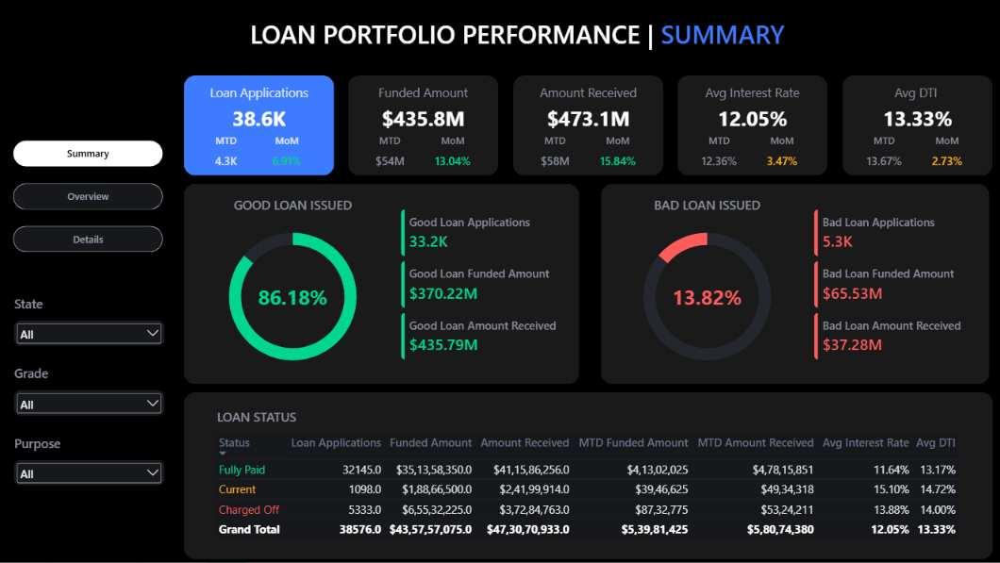
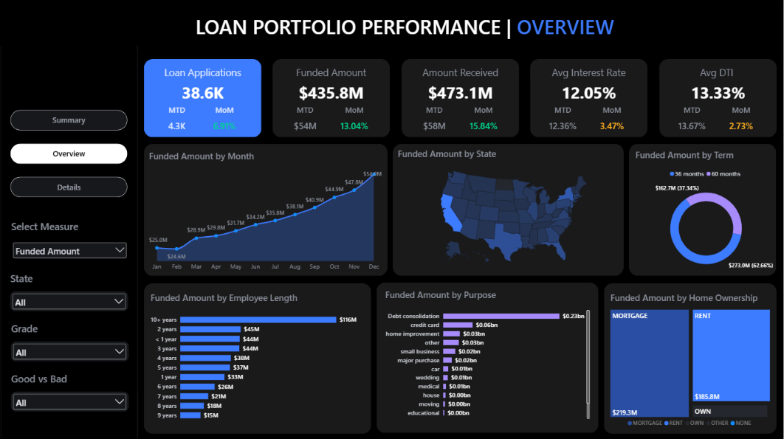
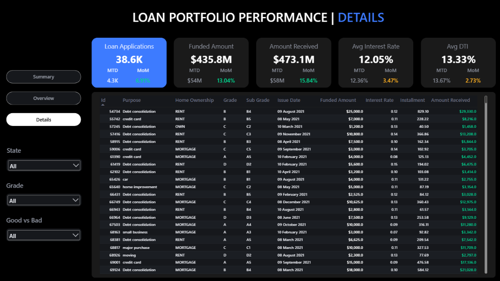

# Bank Loan Portfolio & Risk Analytics

An end-to-end SQL Server and Power BI project exploring loan portfolio performance, repayment outcomes, and lending patterns using historical 2021 loan data.

The focus of this project was not only to build a dashboard, but also to validate the underlying figures, structure the data model, and create reusable calculations that support analysis across multiple report pages.

## Project Overview

The report is organised into three views:

- **Summary:** Portfolio-level KPIs, month-to-date and month-on-month changes, and good versus bad loan indicators.
- **Overview:** Funded amount trends across months, states, loan terms, employment length, loan purposes, and home ownership.
- **Details:** A loan-level view with fields including issue date, loan grade, funded amount, interest rate, instalment, and amount received.

## Technical Workflow

1. Imported the source CSV data into SQL Server for querying and exploration.
2. Queried the data in SQL Server and cross-checked the resulting figures against the corresponding Power BI metrics.
3. Connected SQL Server to Power BI to use the queried data in the report.
4. Created a separate date dimension and corrected model relationships to support time-based analysis and consistent filtering.
5. Developed reusable DAX measures for portfolio KPIs and reporting calculations.
6. Designed a three-page interactive dashboard, using Claude as an aid for exploring a domain-relevant visual layout and presentation.

## Tools & Technologies

- **SQL Server:** Data exploration, querying, and validation
- **Power BI:** Data modelling, report development, and interactive visualisation
- **DAX:** Reusable measures and KPI calculations
- **Dimensional modelling:** Date dimension and model relationships
- **Claude:** AI-assisted exploration of dashboard layout and visual design

## Portfolio Metrics

The dashboard reports the following overall figures for the historical dataset:

| Metric | Reported value |
|---|---:|
| Loan applications | 38.6K |
| Funded amount | $435.8M |
| Amount received | $473.1M |
| Average interest rate | 12.05% |
| Average DTI | 13.33% |

These values are displayed in the report and are presented here as dashboard metrics, not as current market statistics.

## Dashboard Preview

### 1. Portfolio Summary

### 2. Portfolio Overview

### 3. Loan-Level Details

## Repository Contents

- `sql/` — SQL analysis queries
- `dashboard/` — Power BI report and PDF export
- `images/` — Dashboard screenshots

## Scope & Data Context

This project uses historical loan data from 2021. The report explores portfolio performance and loan characteristics within that dataset; it should not be interpreted as a representation of current lending conditions.

# Bank Loan Portfolio & Risk Analytics

An end-to-end SQL Server and Power BI project exploring loan portfolio performance, repayment outcomes, and lending patterns using historical 2021 loan data.

The focus of this project was not only to build a dashboard, but also to validate the underlying figures, structure the data model, and create reusable calculations that support analysis across multiple report pages.

## Project Overview

The report is organised into three views:

- **Summary:** Portfolio-level KPIs, month-to-date and month-on-month changes, and good versus bad loan indicators.
- **Overview:** Funded amount trends across months, states, loan terms, employment length, loan purposes, and home ownership.
- **Details:** A loan-level view with fields including issue date, loan grade, funded amount, interest rate, instalment, and amount received.

## Technical Workflow

1. Imported the source CSV data into SQL Server for querying and exploration.
2. Queried the data in SQL Server and cross-checked the resulting figures against the corresponding Power BI metrics.
3. Connected SQL Server to Power BI to use the queried data in the report.
4. Created a separate date dimension and corrected model relationships to support time-based analysis and consistent filtering.
5. Developed reusable DAX measures for portfolio KPIs and reporting calculations.
6. Designed a three-page interactive dashboard, using Claude as an aid for exploring a domain-relevant visual layout and presentation.

## Tools & Technologies

- **SQL Server:** Data exploration, querying, and validation
- **Power BI:** Data modelling, report development, and interactive visualisation
- **DAX:** Reusable measures and KPI calculations
- **Dimensional modelling:** Date dimension and model relationships
- **Claude:** AI-assisted exploration of dashboard layout and visual design

## Portfolio Metrics

The dashboard reports the following overall figures for the historical dataset:

| Metric | Reported value |
|---|---:|
| Loan applications | 38.6K |
| Funded amount | $435.8M |
| Amount received | $473.1M |
| Average interest rate | 12.05% |
| Average DTI | 13.33% |

These values are displayed in the report and are presented here as dashboard metrics, not as current market statistics.

## Dashboard Preview

### 1. Portfolio Summary

### 2. Portfolio Overview

### 3. Loan-Level Details

## Scope & Data Context

This project uses historical loan data from 2021. The report explores portfolio performance and loan characteristics within that dataset; it should not be interpreted as a representation of current lending conditions.

